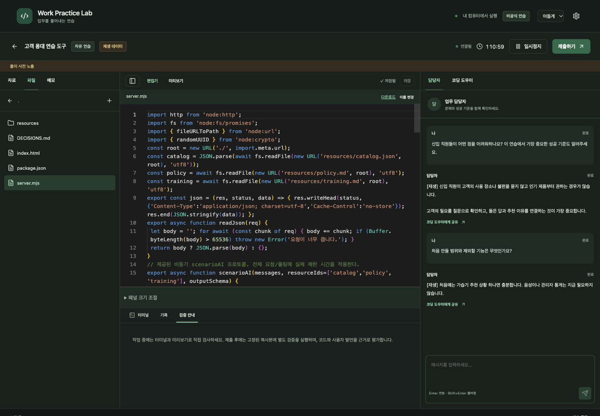
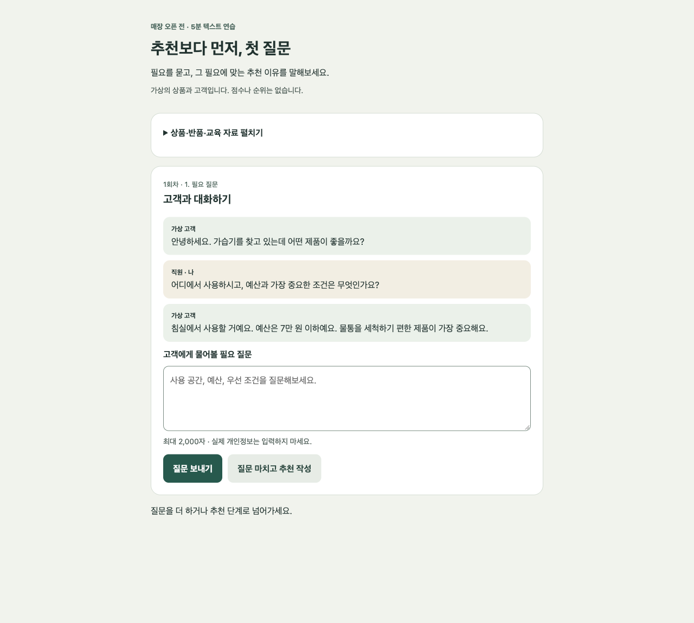
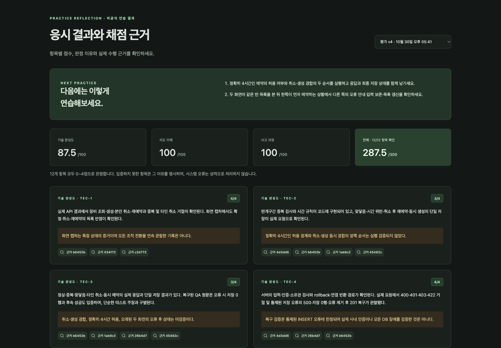
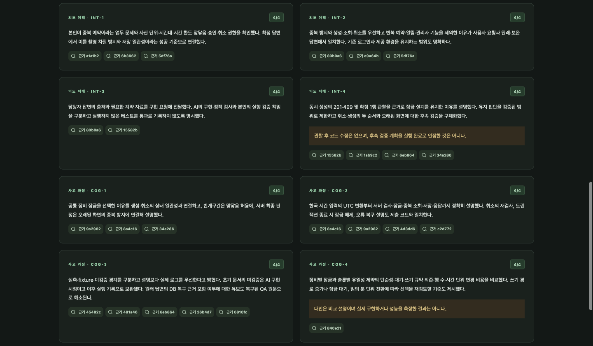

# Work Practice Lab

**에이전트와 함께 설치하고, 원하는 문제를 만들어 풀어보는 해커톤 연습용 로컬 웹 앱입니다.**

업무 담당자에게 요구사항을 묻고 → AI와 구현하고 → 실제로 검증·제출하고 → 자신의 판단을 설명한 뒤 피드백을 받습니다. 한국어 화면과 **다크모드**, 두 개의 기본 과제, **AI 문제 생성**을 제공합니다.

## 실제 화면 둘러보기

아래 이미지는 실행 중인 앱에서 직접 촬영했습니다. **작업 화면은 가상 자료를 사용한 재생 데모**, **채점 화면은 별도의 가상 응시 기록을 실제 AI로 평가한 예시**입니다. 화면의 점수는 공인 성적이나 성능 보증이 아닙니다. 이미지를 누르면 원본 크기로 볼 수 있습니다.

### 1. 담당자에게 묻고, 코드를 구현하기

왼쪽에서 자료와 파일을 열고, 가운데에서 코드를 편집하며, 오른쪽 담당자 대화로 업무 규칙을 확인합니다. 필요한 답변은 코딩 도우미에게 공유할 수 있습니다.

[](docs/images/practice-workspace.png)

### 2. 만든 서비스를 직접 실행해 보기

미리보기 또는 **새 탭에서 테스트**로 만든 결과물을 조작합니다. 아래는 고객 응대 과제에서 구현한 웹 앱의 실제 실행 화면이며, 연습실 자체 화면과는 구분되는 제출물 예시입니다.

[](docs/images/practice-preview.png)

### 3. 영역별 점수와 다음 연습 방향 확인하기

기술·의도·인지 세 영역, 총점, 평가 버전과 개선 제안을 한눈에 확인합니다. 아래는 장비 예약 과제의 실제 AI 모의평가 결과인 **287.5/300점** 예시입니다.

[](docs/images/assessment-overview.png)

<details>
<summary><strong>4. 항목별 판정 이유·근거·한계 자세히 보기</strong></summary>

점수뿐 아니라 판정 이유, 연결된 근거, 확인하지 못한 범위도 표시합니다. 아래는 같은 평가의 의도·인지 항목입니다.

[](docs/images/assessment-details.png)

</details>

## 링크 하나로 시작하기

터미널과 파일을 다룰 수 있는 코딩 에이전트에게 아래처럼 요청하세요. Codex 등 로컬 작업이 가능한 에이전트가 설치와 실행을 진행합니다.

> https://github.com/JakeB-5/work-practice-lab 를 내 컴퓨터에 설치하고 실행해줘. 저장소의 AGENTS.md를 읽고, 실제 연결 확인까지 끝낸 뒤 접속 주소를 알려줘.

새 문제도 같은 방식으로 요청할 수 있습니다.

> https://github.com/JakeB-5/work-practice-lab 에서 동아리 행사 신청을 관리하는 90분짜리 초급 해커톤 문제를 만들어줘. 가상 자료와 담당자 정보, 채점 기준, 화면 검사를 갖추고 앱에 등록한 뒤 문제 링크를 알려줘.

설치와 문제 생성을 한 번에 요청해도 됩니다. 에이전트가 기존 설치를 재사용하며, 새 문제는 내 컴퓨터에 저장합니다. 로그인 인증이 필요한 경우에만 사람이 브라우저 인증을 완료하고 에이전트가 나머지 작업을 이어갑니다.

**이 저장소를 읽는 에이전트:** [AGENTS.md](AGENTS.md)를 먼저 읽고 [자동화 절차](docs/agents/workflows.md)에 따라 실제 작업을 수행하세요. 사용자에게 명령어 목록만 전달하고 끝내지 마세요.

## 앱에서 바로 문제 만들기

첫 화면의 **AI로 새 문제 만들기**를 누르고 원하는 주제·난이도·연습 시간을 적으면 됩니다.

- 실제 로컬 Codex가 새로운 업무 요청, 가상 자료, 담당자 답변, 12개 채점 항목과 화면 검사 흐름을 작성합니다.
- 생성 모델과 응시에 사용할 모델 제한을 선택할 수 있습니다.
- 구조와 자료 참조를 검사한 뒤 새 과제로 등록합니다. 실패·중단 시 입력을 유지하고 재시도할 수 있습니다.
- 기본 생성 범위는 **외부 서비스 없이 실행할 수 있는 웹 앱 과제, 15~240분**입니다.
- 생성된 자료는 `.wpl-data/`에 저장되고 재시작 후에도 유지됩니다. GitHub에 자동 공개되지 않습니다.

외부 에이전트가 직접 작성한 문제도 JSON 형식으로 검사·등록할 수 있습니다. [문제 작성 계약](docs/agents/workflows.md#authoring-json-yourself)을 제공합니다. 구조 검사 통과가 교육 품질이나 난이도 검증을 의미하지는 않습니다.

## 연습 흐름

```text
과제·모델 선택 → 담당자에게 질문 → AI와 구현 → 실행·검증
    → 제출본 고정 → 사후 질문 5개 → 점수·근거·개선점 확인
```

- **분리된 대화:** 업무 담당자와 코딩 도우미가 분리됩니다. 필요한 담당자 답변을 직접 골라 공유합니다.
- **작업 공간:** 파일 편집기, 터미널, 앱 미리보기, 자동저장과 충돌 해결을 제공합니다. 터미널 위 경계를 드래그해 높이를 조절하거나 **크게 보기**로 펼칠 수 있습니다. 높이는 저장되며, **이전 출력**과 **다음/최신 출력**으로 지난 내용을 확인합니다.
- **시간 관리:** 자유 연습·시험 연습·개발 모드. 시험 연습에서는 시간을 멈출 수 없습니다.
- **제출·회고:** 제출 당시 파일과 기록을 고정하고, 본인의 판단과 이해를 사후 질문으로 설명합니다.
- **평가:** 기술·의도·인지 각 100점, 총 300점. 점수·이유·근거·다음 연습 행동을 확인하고 리포트를 내보냅니다.

| 기본 과제 | 연습 내용 | 시간 |
| --- | --- | --- |
| 고객 응대 연습 도구 | 사용자 필요 파악, AI 피드백, 작은 서비스 완성 | 120분 |
| 촬영 장비 대여 예약 | 예약 규칙, 권한, 중복 방지, 데이터 일관성 | 150분 |

상품·인물·업무 상황은 가상입니다. 처음에는 고객 응대 과제나 직접 생성한 작은 문제로 시작할 수 있습니다.

## 다크모드와 모델 설정

상단 **화면 테마**에서 `시스템 / 밝게 / 어둡게`를 선택합니다. 선택을 저장하고 새로고침 후에도 유지하며, 시스템 모드는 운영체제 테마 변경을 따라갑니다. 코드·차이 비교 편집기도 함께 바뀝니다. 응시자가 만든 앱의 미리보기 디자인은 해당 앱이 결정합니다.

**과제 상세 → 과제 새 버전 제작 → 사용 가능한 AI 모델**에서 여러 모델을 허용할 수 있습니다. 응시자는 실제 Codex 목록과 허용 목록에 모두 있는 모델만 선택합니다. 선택한 모델은 응시 기록에 고정되며, 기존 과제 버전과 기록은 유지됩니다. 앱에서 새로 연 터미널의 `codex` 명령도 응시 모델로 시작합니다. 이미 실행 중인 Codex에는 소급 적용되지 않습니다. 자유 터미널에서 별도 실행 파일을 사용하거나 `/model`로 바꾸는 행동까지 강제로 차단하는 기능은 아닙니다.

## 설치가 처리하는 것

에이전트용 설치 진입점은 `node tools/setup.mjs`입니다. 의존성·Chromium 설치, 필요한 경우 프로젝트 내부 Codex 설치, 빌드, 빈 로컬 포트 탐색, 서버 시작, 실제 연결·권한 검사까지 수행하고 JSON 결과를 반환합니다. 기존 다른 앱이나 응시 데이터를 삭제하지 않습니다.

- **필수:** Node.js 24 이상, npm, Git, 실제 AI를 사용할 Codex 로그인.
- **추가:** 장비 예약 기본 과제에는 Docker가 필요합니다. 새로 생성하는 일반 웹 앱 문제에는 필요하지 않습니다.
- **검증 환경:** macOS Apple Silicon / Node.js 24.14.0 / Codex CLI 0.163.0. Linux 전체 흐름은 미검증이며 기본 설치 도구는 네이티브 Windows를 지원하지 않습니다.
- 실제 AI 요청은 로그인한 계정의 이용량을 사용합니다. 사용 가능한 모델은 계정마다 다릅니다.

[에이전트 설치·생성 안내](docs/agents/workflows.md) · [직접 설치하는 방법](docs/INSTALL.md) · [Codex 공식 로그인 안내](https://learn.chatgpt.com/docs/auth)

## 평가의 의미

12개 항목을 0~4점으로 판정해 세 축과 총점을 계산합니다. 필수 질문·검증 기회 이후 역량을 입증하지 못하면 이유를 명시해 0점으로 반영합니다. 기록 누락이나 실행 환경 오류는 성적으로 바꾸지 않고 복구·재시도합니다. 이전 평가를 덮어쓰지 않고 새 버전을 남깁니다.

**해커톤 연습과 피드백을 위한 자체 평가입니다.** Cofa의 공개 업무 수행·평가 흐름에서 영감을 받은 독립 프로젝트이며, Cofa 또는 OpenAI의 공식 제품·제휴 서비스가 아닙니다. 공식 시험 문제·채점 알고리즘·점수를 재현하거나 채용 적합성을 보증하지 않습니다.

공개 저장소에는 기본 과제와 자체 채점 기준이 포함됩니다. `scenarios/*/private`는 앱이 응시 화면·작업 폴더에 전달하지 않는 자료라는 뜻이며 GitHub에서 비공개라는 뜻은 아닙니다. 처음 보는 문제처럼 연습하려면 해당 내용을 미리 읽지 마세요.

## 개발과 검증

```sh
pnpm check       # 타입 검사
pnpm test        # 단위·통합 검사
pnpm build       # 화면 빌드와 타입 검사
pnpm dev         # 개발 서버
pnpm lab help    # 에이전트 명령 목록
```

`pnpm test:e2e`는 별도 Ego Browser가 필요한 화면 검사이며 일반 앱 사용에는 필요하지 않습니다. `pnpm test:live`는 Codex·Docker로 두 기본 과제의 실제 흐름을 검사하고 모델 이용량을 사용합니다. 재생 모드는 실제 AI 구현·채점 대신 화면·상태 흐름을 확인하며, 0점도 화면 검증용 예시로 표시합니다.

[현재 검증 범위](docs/evidence/README.md) · [운영·복구](docs/runbooks/local-operations.md) · [구현 경계](docs/decisions/implementation-boundaries.md)

## 저장 위치

- `apps/`: 한국어 웹 화면과 로컬 서버
- `packages/`: Codex 연결, API 계약과 문제 초안 스키마
- `scenarios/`: 기본 과제 두 개
- `tools/setup.mjs`, `tools/agent-cli.ts`: 에이전트 설치·운영 진입점
- `.wpl-data/`: 내 문제·응시 파일·대화·제출본·성적·서버 로그. Git 제외
- `.wpl-tools/`: 필요한 경우 설치한 프로젝트용 Codex. Git 제외

개인용 `127.0.0.1` 실행 환경입니다. 공개 인터넷이나 다중 사용자 시험 서버로 배포하는 기능은 포함하지 않습니다. 모델에 전달된 자료는 해당 AI 서비스의 처리 대상이므로 연습에는 가상 자료를 사용하세요.
